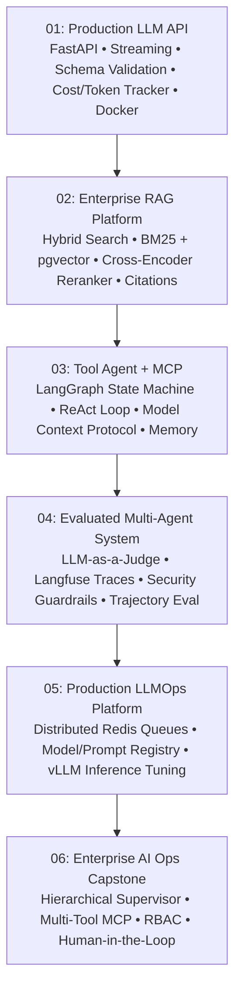

# 🚀 AI-Engineer: World-Class AI Systems & Engineering Portfolio

Welcome to the **AI-Engineer** repository — a production-grade portfolio designed around the **6-Month World-Class AI Engineering Roadmap**.

This repository bridges the gap between course tutorials and industrial AI systems engineering, showcasing six enterprise-grade projects across LLM Gateways, Hybrid RAG, LangGraph Agent Systems, Model Context Protocol (MCP), Observability, and LLMOps.

---

## 📂 Repository Structure

```
AI-Engineer/
├── 00_MASTER_ROADMAP/
│   └── AI_Engineering_Master_Roadmap.md         # The complete 6-month roadmap & execution model
├── 01_LLM_ENGINEERING/                          # Tokenization, Attention, Architecture & Prompting
├── 02_RAG_ENGINEERING/                          # Chunking, Embeddings, Vector DBs, Hybrid Search
├── 03_AGENT_ENGINEERING/                        # ReAct, State Machines, LangGraph & Memory
├── 04_MCP/                                      # Model Context Protocol Servers & Clients
├── 05_MULTI_AGENT/                              # Supervisor, Specialist Swarms & Handoffs
├── 06_EVALUATION/                               # RAGAS, LLM-as-Judge, Trajectory Evals
├── 07_OBSERVABILITY/                            # OpenTelemetry, Langfuse Tracing & Latency
├── 08_AI_SECURITY/                              # Prompt Injection, Guardrails & Sandboxing
├── 09_LLMOPS/                                   # Model Registries, Versioning, CI/CD
├── 10_DEPLOYMENT_CLOUD/                         # Docker, Kubernetes, AWS/GCP AI Infra
├── 11_INFERENCE_OPTIMIZATION/                   # vLLM, Quantization (GGUF/AWQ), KV Caching
├── 12_FINE_TUNING/                              # SFT, LoRA, QLoRA, DPO Alignment
├── 13_MULTIMODAL/                               # Vision-Language Models, OCR & Audio
├── 14_VOICE_AI/                                 # Speech-to-Speech & Real-time Agents
├── 15_COMPUTER_USE/                             # OS/Browser Automation Agents
├── 16_HARNESS_CONTEXT_ENGINEERING/              # Verification Harnesses & Context Windows
├── 17_AI_SYSTEM_DESIGN/                         # Architecting for 1M+ Users & Enterprise Scale
├── PROJECTS/
│   ├── 01_production_llm_api/                   # [Month 1] High-performance Resilient LLM Gateway
│   ├── 02_enterprise_rag_platform/              # [Month 2] Hybrid RAG (Dense+BM25) with Reranking
│   ├── 03_tool_using_agent_mcp/                 # [Month 3] LangGraph State Machine with MCP
│   ├── 04_evaluated_multi_agent_system/         # [Month 4] Evaluated & Observable Agent Swarm
│   ├── 05_production_llmops_platform/           # [Month 5] Distributed Worker Queue & Registry
│   └── 06_enterprise_ai_operations_platform/    # [Month 6] Capstone: Enterprise Autonomous Operations
└── INTERVIEW_PREPARATION/                       # System Design, Flashcards, Technical Drills
```

---

## 🏆 The 6 Portfolio Projects



### 1. [Production LLM API](file:///C:/Users/user/.gemini/antigravity/scratch/AI-Engineer/PROJECTS/01_production_llm_api)
- **Features**: Multi-provider LLM Gateway (OpenAI, Anthropic, Gemini, Ollama), SSE Streaming, strict Pydantic v2 structured outputs, automated retry with exponential backoff, circuit breaking, dynamic token & cost tracking.
- **Stack**: FastAPI, Pydantic, HTTPX, Tenacity, Docker, Redis.

### 2. [Enterprise Knowledge Intelligence Platform](file:///C:/Users/user/.gemini/antigravity/scratch/AI-Engineer/PROJECTS/02_enterprise_rag_platform)
- **Features**: Multi-format document parser (PDF, DOCX, CSV, Web), hierarchical chunking, dense vector embeddings + sparse BM25 retrieval, Reciprocal Rank Fusion (RRF), Cross-Encoder reranker, verified citation generator.
- **Stack**: PostgreSQL, `pgvector`, BM25, Sentence-Transformers / FlashRank, FastAPI.

### 3. [Tool-Using Agent + Model Context Protocol (MCP)](file:///C:/Users/user/.gemini/antigravity/scratch/AI-Engineer/PROJECTS/03_tool_using_agent_mcp)
- **Features**: LangGraph state machine agent with explicit checkpoints and state rollback, ReAct loop with reflection, short/long-term memory persistence, MCP clients connecting Database, CRM, and Web tools.
- **Stack**: LangGraph, MCP Python SDK, SQLite / Postgres state persistence.

### 4. [Evaluated, Observable & Secure Multi-Agent System](file:///C:/Users/user/.gemini/antigravity/scratch/AI-Engineer/PROJECTS/04_evaluated_multi_agent_system)
- **Features**: Automated evaluation suite (Faithfulness, Groundedness, Trajectory Correctness), OpenTelemetry and Langfuse distributed tracing, input injection guardrails, tool sandboxing, and output PII redaction.
- **Stack**: Langfuse, OpenTelemetry, Ragas, NeMo Guardrails.

### 5. [Production LLMOps Platform](file:///C:/Users/user/.gemini/antigravity/scratch/AI-Engineer/PROJECTS/05_production_llmops_platform)
- **Features**: Distributed asynchronous worker pipeline for batch jobs, prompt and model registry with semantic versioning, continuous batching and quantization benchmarks, automated CI/CD eval gates.
- **Stack**: Redis, Celery / RQ, Docker, GitHub Actions, vLLM.

### 6. [Enterprise Autonomous AI Operations Platform (Capstone)](file:///C:/Users/user/.gemini/antigravity/scratch/AI-Engineer/PROJECTS/06_enterprise_ai_operations_platform)
- **Features**: Full enterprise platform combining an API Gateway with RBAC, Supervisor Orchestrator, specialist agent swarm (RAG, SQL, Web Research), MCP tool ecosystem, Human-in-the-loop approval gates, and production observability.
- **Stack**: FastAPI, LangGraph, PostgreSQL + pgvector, Redis, MCP, Docker Compose.

---

## 🛠️ Quick Start (Running Project 1: Production LLM API)

```bash
# Navigate to Project 1
cd PROJECTS/01_production_llm_api

# Install dependencies with uv or pip
pip install -r requirements.txt

# Start the API server
uvicorn app.main:app --reload --port 8000
```

Access the interactive API docs at `http://localhost:8000/docs`.

---

## 📖 Methodology & Daily Engineering Habits
- **30% Learning**: Reading source documentation, whitepapers, and architecture guides.
- **60% Building**: Writing tested, production-ready systems with Docker containers.
- **10% Interview Prep**: System design whiteboard practice, technical trade-off defenses, and flashcard drills.